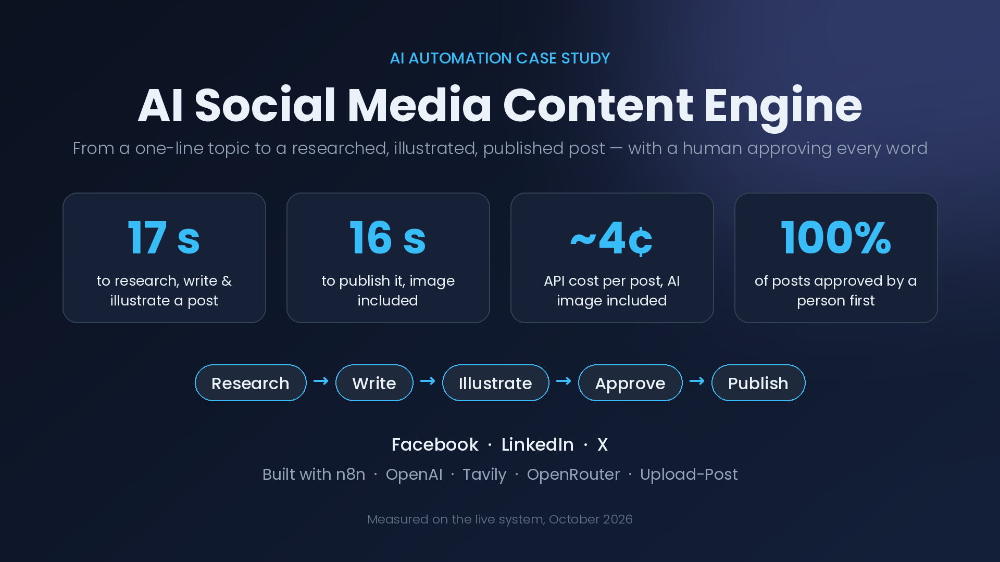
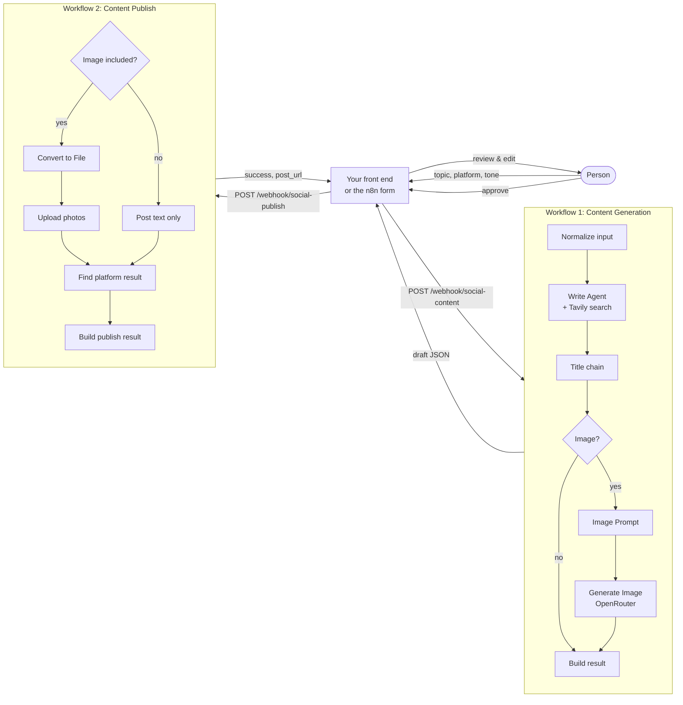
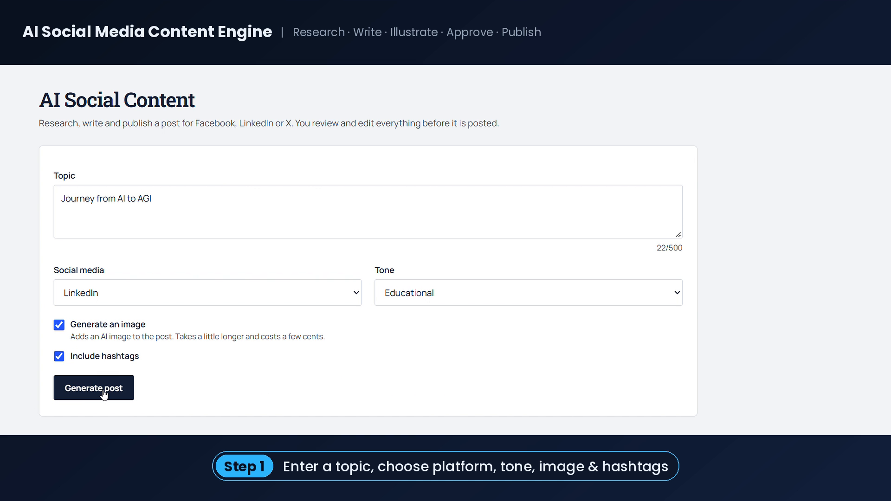
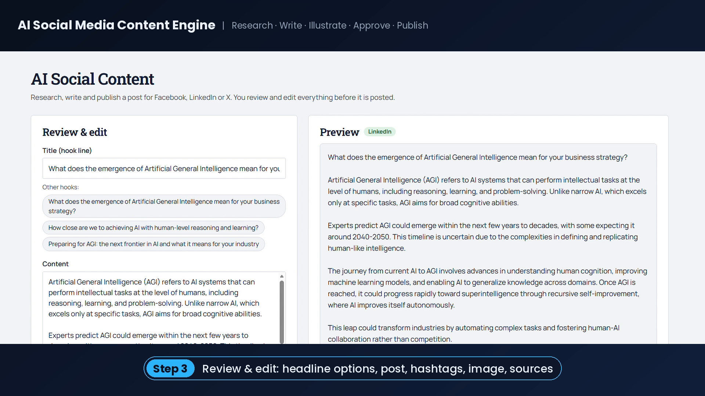
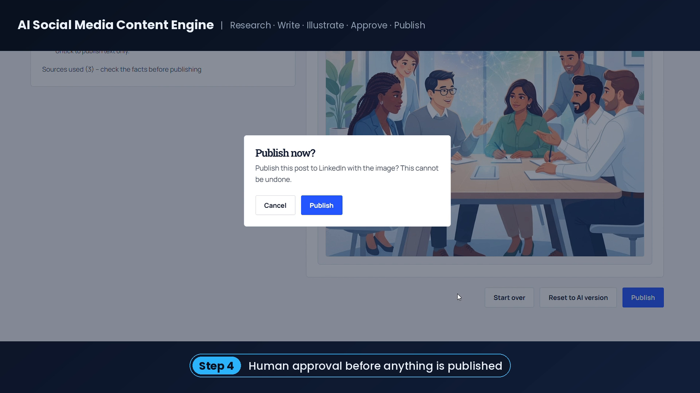
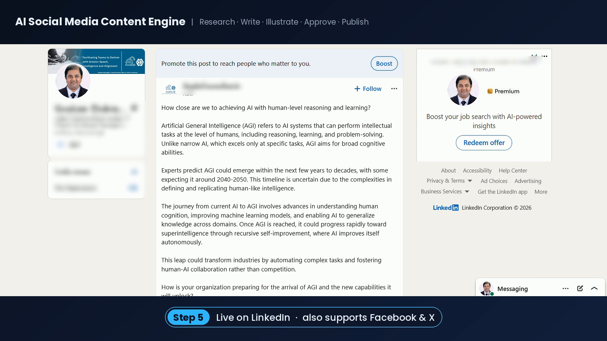
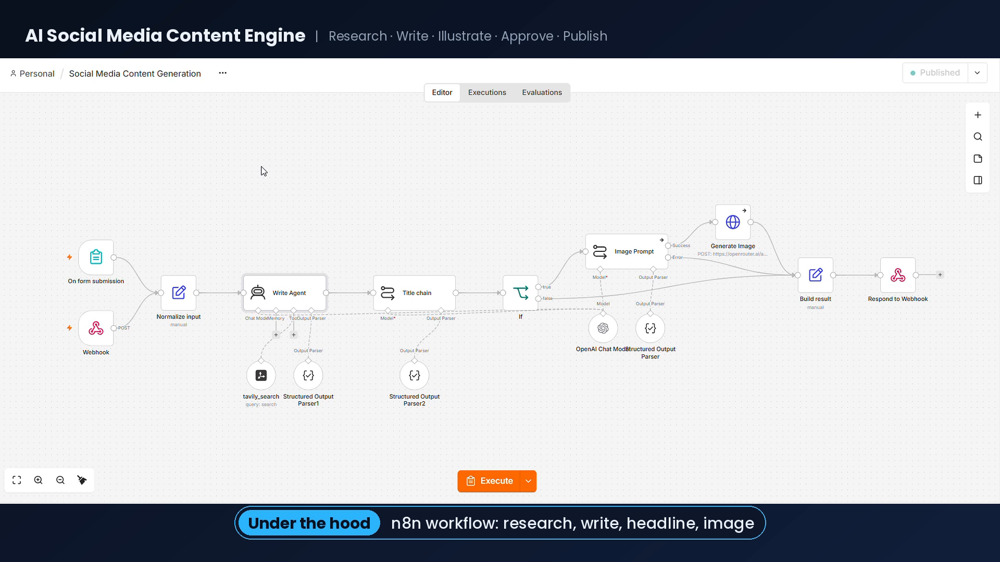
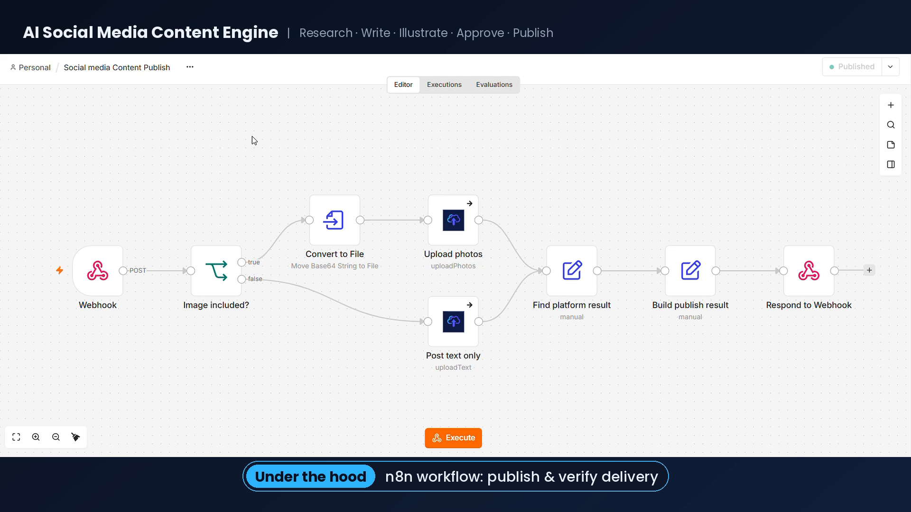

# AI Social Media Content Engine

**Turn a one-line topic into a researched, illustrated, ready-to-publish social media post for LinkedIn, Facebook or X, with a human approving every word before it goes live.**

Built with two [n8n](https://n8n.io) workflows, OpenAI, Tavily web search, OpenRouter image generation and Upload-Post.



▶️ **Demo video (90 s):** https://youtu.be/fmZgccN5Rqk?si=4grra-1jbtROst8i

---

## Why

A good social media post takes research, a strong hook, a visual, hashtags and time. Done by hand, consistency is the first thing to suffer. This project automates the slow parts and keeps a person in charge of what gets published.

## Results (measured on the live system, October 2026)

| Metric | Value |
|---|---|
| Generate a text-only post | **9 s** |
| Generate a post with an AI image | **17 s** |
| Publish a post with an image | **16 s** |
| AI image cost per post | **$0.033** (measured) |
| Text cost per post | **< $0.01** (estimate) |
| Posts published without human approval | **0** |

## Features

- **Live web research.** An AI agent searches the web with Tavily before writing, so posts use current facts.
- **Platform-aware writing.** Length and style rules for LinkedIn, Facebook and X, in 10 tones (professional, educational, storytelling, thought leadership, hot take and more).
- **Headline plus alternatives.** A separate step writes the title and two alternative hooks.
- **Optional AI image.** An art-director prompt step and an image model create a full-bleed, text-free image sized for the platform.
- **Hashtags and sources.** Every draft lists the sources it used, so facts can be checked.
- **Human in the loop.** Generation and publishing are separate workflows; nothing is posted until a person approves.
- **Verified publishing.** The publish workflow reads the platform's own result, not just the API's top-level `success`, so a failed post is never reported as live.
- **Fail soft.** If image generation fails, the written post is still returned.

## How it works



More detail is in [docs/architecture.md](docs/architecture.md).

## Screenshots

| Step | Screenshot |
|---|---|
| 1. Enter a topic |  |
| 2. Review and edit the draft |  |
| 3. Human approval |  |
| 4. Published |  |
| Generation workflow |  |
| Publish workflow |  |

## Repository structure

```
├── workflows/
│   ├── social-media-content-generation.json   # Workflow 1 (15 nodes)
│   └── social-media-content-publish.json      # Workflow 2 (8 nodes)
├── docs/
│   ├── setup.md            # Install, credentials, import, first test
│   ├── architecture.md     # Components, node-by-node design, decisions
│   ├── api.md              # Webhook request/response contracts
│   ├── security.md         # Secrets, threat model, AI risks
│   ├── testing.md          # Test cases
│   └── troubleshooting.md  # Common errors and fixes
├── examples/               # Sample requests/responses and curl commands
├── scripts/
│   └── sanitize_n8n_export.py  # Clean an n8n export before sharing it
└── assets/                 # Screenshots and cover image
```

## Quick start

1. Install the community nodes `@tavily/n8n-nodes-tavily` and `n8n-nodes-upload-post` on your n8n instance.
2. Create credentials for OpenAI, Tavily, OpenRouter, Upload-Post and a Header Auth secret for the webhooks.
3. Import both files from `workflows/`, select your credentials in each node, and set your Upload-Post profile name in the **Upload photos** and **Post text only** nodes.
4. Edit the brand description in the **Write Agent**, **Title chain** and **Image Prompt** system prompts.
5. Activate both workflows and run the examples in [examples/](examples/).

Full instructions: [docs/setup.md](docs/setup.md).

> **Front end:** the workflows are called through two authenticated webhooks, so any front end can drive them: a web admin page, an internal tool, or plain `curl`. The front end used in the demo is not part of this repository. The generation workflow also has a built-in n8n form for testing without a front end.

## Tech stack

| Part | Technology |
|---|---|
| Orchestration | n8n (tested on 2.43.6) |
| Writing, titles, image prompts | OpenAI `gpt-4.1-mini` via n8n AI Agent / Basic LLM Chain |
| Web research | Tavily (basic depth, 5 results) |
| Image generation | OpenRouter `google/gemini-3.1-flash-lite-image` |
| Publishing | Upload-Post (Facebook, LinkedIn, X) |

## Limitations and roadmap

- One platform per post. Multi-platform publishing from one draft is on the roadmap.
- No scheduling or drafts library (scheduling through Upload-Post is planned).
- X posts can occasionally exceed 280 characters; the front end should block over-limit posts. A "shorten for X" step is planned.
- No automatic retry on transient AI errors yet; enabling **Retry On Fail** on the AI and image nodes is recommended.
- OpenAI plans to retire the GPT-4.1 models in January 2027; switch the **OpenAI Chat Model** node to a current model before then.

## License

[MIT](LICENSE)
