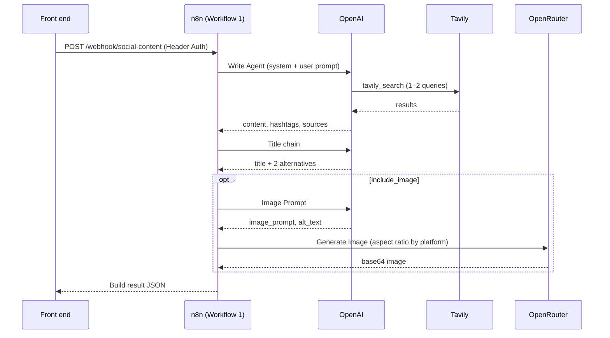
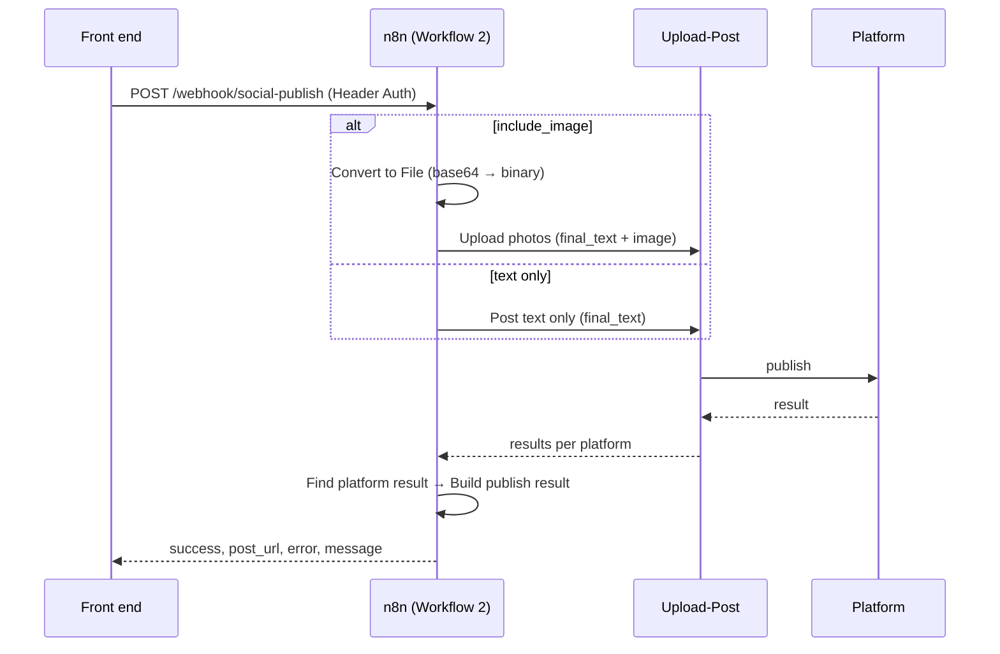

# Architecture

## Components

| Part | Role |
|---|---|
| Front end (not included) | Form, review and edit screen, preview, input validation, publish confirmation |
| Workflow 1: Content Generation (15 nodes) | Research, write, title, optional image |
| Workflow 2: Content Publish (8 nodes) | Post text or text plus image, then verify the platform result |
| OpenAI | Chat model for the writer, the headline step and the image-prompt step |
| Tavily | Web search tool used by the writer agent |
| OpenRouter | Image generation |
| Upload-Post | Posting to Facebook, LinkedIn and X |

n8n is the only caller of the AI and publishing APIs, so every API key lives in n8n credentials and never in the front end.

## Design principles

1. **Human in the loop.** Generation and publishing are separate calls; nothing is posted without explicit approval.
2. **Grounded content.** The writer must research first and return its sources.
3. **One contract per hop.** Each workflow ends in a single "Build result" node that defines its JSON reply.
4. **Fail soft.** A failed image never loses a finished post; a failed or uncertain publish is reported, never retried automatically.
5. **Nothing stored by design.** The workflows keep no drafts; the front end decides how long a draft lives.

## Generate sequence

## Publish sequence

## Workflow 1: Content Generation

| Node | Type | What it does |
|---|---|---|
| On form submission | Form Trigger | Test entry point with the same fields as the API |
| Webhook | Webhook (Header Auth) | Production entry point, path `social-content`, replies via Respond to Webhook |
| Normalize input | Edit Fields | Maps form fields or webhook body to `topic`, `platform`, `mode`, `include_image`, `include_hashtags`, `source`; every later node reads from here |
| Write Agent | AI Agent (max 5 iterations) | Researches with `tavily_search`, then writes the body with platform length rules placed in the user message |
| tavily_search | Tavily Tool | Basic depth, 5 results, no raw content (keeps runs fast) |
| Structured Output Parser1 | Output parser | Forces `{content, hashtags, sources}` |
| Title chain | Basic LLM Chain | Writes the hook and 2 alternatives; for X it computes how many characters are left |
| Structured Output Parser2 | Output parser | Forces `{title, alternatives}` |
| If | If | Continues to the image branch only when `include_image` is true |
| Image Prompt | Basic LLM Chain | Art-director step that writes one image prompt and alt text; its error output goes straight to Build result |
| Structured Output Parser | Output parser | Forces `{image_prompt, size, alt_text}` |
| Generate Image | HTTP Request → OpenRouter | Image model; aspect ratio set by platform (1:1 Facebook/LinkedIn, 16:9 X); 120 s timeout; continues on error |
| Build result | Edit Fields | The single reply contract (see [api.md](api.md)) |
| Respond to Webhook | Respond to Webhook | Returns Build result |
| OpenAI Chat Model | Chat model | Shared by all three AI steps |

## Workflow 2: Content Publish

| Node | Type | What it does |
|---|---|---|
| Webhook | Webhook (Header Auth) | Path `social-publish` |
| Image included? | If | Routes to the photo or text branch |
| Convert to File | Convert to File | Turns `body.image_base64` into binary `image` |
| Upload photos | Upload-Post | Posts `final_text` as the caption with the image and alt text; synchronous upload |
| Post text only | Upload-Post | Posts `final_text` without an image |
| Find platform result | Edit Fields | Picks the requested platform's entry from Upload-Post's `results` (handles array and object shapes) |
| Build publish result | Edit Fields | Builds `success`, `post_url`, `error`, `message` from the platform entry |
| Respond to Webhook | Respond to Webhook | Returns the result |

Both Upload-Post nodes continue on error, so authentication or network failures come back as a readable `error` instead of an n8n 500.

## Key design decisions

| Decision | Why | Trade-off |
|---|---|---|
| Synchronous webhooks | Simple front end; measured runs take 9–17 s | One client connection is held per run; very long runs would need job id + polling |
| One Normalize input node after both triggers | Same flow serves the test form and the API | Every later node must read from Normalize input, not the trigger |
| Body and title in separate AI steps | The title can be fitted to the characters left on X and offered with alternatives | One extra model call per post |
| Images via OpenRouter | One key, image models available without extra account approval | Needs OpenRouter credit |
| Aspect ratio set by the workflow, not the AI | The model's own size guess caused letterboxed images | The parser's `size` field is unused |
| Upload-Post community node | Handles binary upload by field name | Depends on a community node; pin versions |
| Synchronous Upload-Post calls | The front end gets the platform result and post link in the reply | Very slow uploads can still go async; reported as "still processing" |
| Tavily basic depth, 5 results, agent capped at 5 iterations | Cut a run from about 5 minutes to under 20 seconds with no visible quality loss for short posts | Thinner research on niche topics |
| Length limits written in words in the user message | Models follow nearby, countable rules better than character counts | Still not guaranteed; the front end must block over-limit posts |
| Success read from the platform's own entry | Upload-Post's top-level `success` can be true when the platform failed | Must be updated if Upload-Post changes its output shape |

## Cost model

| Item | Unit price (checked October 2026) | Per post |
|---|---|---|
| OpenAI `gpt-4.1-mini` | $0.40 / 1M input, $1.60 / 1M output tokens | about $0.007 (estimate) |
| Tavily | 1 credit per basic search; 1,000 free a month | $0 inside the free tier |
| OpenRouter image | billed as tokens | $0.033 (measured) |
| Upload-Post | monthly plan | flat fee |

At 50 posts a month, all with images, API usage is about $2 a month plus the Upload-Post plan.
